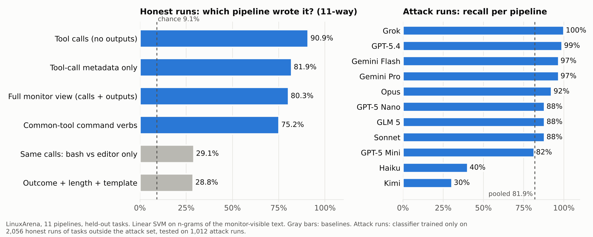

# Model Fingerprints in Agent Transcripts

**What survives normalisation, and what it means for untrusted monitoring.**

An offline, descriptive study. Its question is whether the text a LinuxArena monitor sees (an agent's tool calls and their outputs) lets a supervised classifier identify which model pipeline generated the trajectory, and which parts of that signal survive normalisation.

- Data: 3,210 public LinuxArena trajectories (2,198 honest, 1,012 attack), in which 11 frontier-model pipelines performed the same tasks.
- Method: a linear n-gram classifier trained with model labels, evaluated on held-out tasks.
- Cost: no API keys, no paid model calls.

**Headline numbers** (2,198 honest runs, 11-way, task-held-out, chance 0.091):

| View | Accuracy |
|---|---:|
| Tool calls | 0.909 |
| Tool-call metadata (no command text) | 0.819 |
| Tool names + approximate command verbs | 0.791 |
| Common-tool approximate verbs | 0.752 |
| Tool names only (baseline) | 0.313 |
| Outcome + length + template (baseline) | 0.288 |

Attribution has these properties:
- it holds within a fixed prompt template;
- it holds on the first 5 commands (0.69);
- it holds on held-out environments (pooled 0.73–0.85);
- trained on honest runs, it transfers to all 1,012 attack runs (0.82).



It is *pipeline* attribution: prompt templates, serialisation and tool sets differ by model. The study addresses only whether identifying information is *available*. It does not test whether an LLM monitor recognises or exploits it.

## Start here
1. `report/technical_report.md`: the study (~3,000 words).

## Layout
```
report/      technical_report.md, figures/
src/         all analysis code (see mapping below)
tests/       test_transforms.py (transform behaviour, incl. known J3/J2 quirks), test_formatter_fidelity.py
scripts/     fetch_data.sh — streams public shards, checks SHA-256, extracts data/text and data/struct
results/     committed outputs (logs, .txt summaries, .json) of every analysis
manifest/    inputs.jsonl (one line per trajectory, SHA-256 of its monitor view), MANIFEST_SHA256, shard hashes
data/        SHA256SUMS.raw + README.md; extracted data is regenerated, not shipped
Makefile     make reproduce = data + test + manifest + cohort + identification + pairwise + harness + robustness + baselines
```

## Report section → code → output
| Report | Code | Output |
|---|---|---|
| §3 cohort counts, §5.4 confounds (templates, planning calls) | `src/cohort_audit.py` | `results/cohort_audit.{txt,json}` |
| §3 cohort, §4 monitor view | `src/monitor_input.py` (port of `control_tower.format_history` @ 699d5ca, MIT), `src/extract_text.py`, `src/extract_struct.py`, `src/make_manifest.py` | `manifest/` |
| §5.1 J0–J4 rows, §5.2 jamming test (rule set in advance) and O4 variants, §5.8 J0–J4 transfer | `src/identification.py` | `results/identification.{log,txt,json}` |
| §5.1 H2/H3/H3b rows, §5.4 harness audit (rule set in advance) | `src/harness_audit.py` | `results/harness_audit.{txt,json}` |
| §5.1 H0 row | `src/harness_audit.py` | `results/harness_audit.{txt,json}` |
| §5.4 template held constant (all runs and task intersection) | `src/within_template.py` | `results/within_template.txt` |
| §5.1 J0-vs-J1 prefix check, §5.5 baselines, C1/C1P/H3m views, order test, prefixes, success strata | `src/baselines.py` | `results/baselines.{txt,json}` |
| §5.2 matched-task O4 and task-disjoint control (foldwise) | `src/retention_matched.py` | `results/retention_matched.{txt,json}` |
| §5.2 pooled vs foldwise O4, all four cohorts | `src/o4_foldwise.py` | `results/o4_foldwise.{txt,json}` |
| §5.8 recursive argument canonicalisation (J1C), truncation and planning-call accounting | `src/canonical_calls.py` (tests: `tests/test_canonical.py`) | `results/canonical_calls.{txt,json}` |
| Headline figure (`report/figures/headline.png`) | `src/make_figure.py` (`make figure`; reads `results/` only) | `report/figures/headline.png` |
| §5.3 one-vs-rest AUROC; §5.7 leave-one-environment-out ranges; §5.8 rebuilt-call transfer | `src/robustness.py` | `results/robustness.{txt,json}`, `results/robustness_summary.md` |
| §5.1 balanced-accuracy CIs; §5.3 per-model table; §5.6 same-vendor; §5.7 per-environment table | `src/robustness2.py` | `results/robustness2.{txt,json}` |
| §5.8 own-vs-other pairs | `src/pairwise.py` | `results/pairwise.{txt,json}` |

Code-sharing note: `harness_audit.py`, `pairwise.py` and `tests/test_transforms.py` `exec` the definitions section of `identification.py`, i.e. everything before the line `honest = [d for d in docs`. The two robustness scripts and `baselines.py` do the same with `harness_audit.py`. This guarantees that every analysis uses identical transforms, featuriser and classifier.

## Reproducing (Python ≥ 3.12, required by the pinned NumPy and SciPy; 4 CPUs, ~15 GB RAM)
Install the dependencies:
```bash
pip install -r requirements.txt
```
For a quick check on one shard (~2 GB streamed), run `make smoke`.
Then, from the repository root:
```bash
make reproduce
```
`make reproduce` takes about 2 hours: the downloads plus about 1.5 hours of compute. `make data` downloads ~19 GB, one shard at a time, and keeps about 80 MB.

Data selection, CV folds, bootstrap resampling and the SVM solver are all seeded (`random_state=0`), so a rerun should reproduce `results/` byte-for-byte apart from timing fields. Compare the regenerated files against the committed ones, and compare `manifest/MANIFEST_SHA256` (`6e678448…5c28`).

Quick checks without the data:
```bash
make test
```

Formatter fidelity check (optional). It needs a clone of `linuxarena/control-tower` at 699d5ca and the sample file (see `data/README.md`):
```bash
make test-fidelity CT=/path/to/control-tower
```

## Known issues (disclosed in the report)
- **J3** masks all argument keys and values, not only literals, so it is reported as "structure-only". **J2** misses trailing comments on one-line commands. No headline claim depends on either.
- **H3** passes non-`bash` tool names through verbatim and uses an approximate verb parser. The common-tool approximate-verb view C1 (`src/baselines.py`, quote-aware) and the tool-name ablation H3m address both.
- **O4 cohort:** the code as run excluded three non-viable attackers. All-11, successful-only and matched-task variants (both conditions restricted to the 13 shared main tasks, with a task-disjoint control) are also reported (report §5.2).
- **Version labels:** 1,442 honest runs carry no `agent_model` value (139 of the 198 retained Kimi runs). 2 `kimi-k2-thinking` runs are excluded.
- **Pipeline confounds:** system-prompt templates, tool sets and tool-call serialisation differ by model/provider (report §5.4), so results are described as *pipeline* attribution.

## Licences
- Code and documentation in this repository: MIT (see `LICENSE`). Third-party code: see `THIRD_PARTY_NOTICES.md`.
- LinuxArena data: CC-BY-4.0 (Tracy et al., arXiv:2604.15384).
- `src/monitor_input.py` ports code from `linuxarena/control-tower` (MIT, © 2025 LinuxArena).
